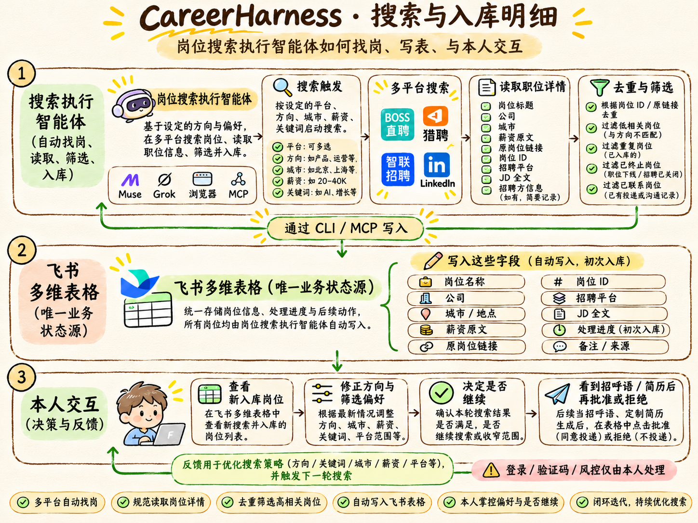

<p align="center">
  
</p>

<p align="center">
  <strong>可能是全网最想帮你找到工作的求职搭子。</strong>
</p>

<p align="center">
  帮你找岗位、读 JD、准备招呼语和定向简历，也会慢慢记住你的修改和偏好。你负责选择和拍板，它负责把重复琐事接过去。
</p>

CareerHarness 用一张飞书多维表格，把岗位搜索、内容准备、人工审批和持续复盘连在一起。

## 一张表，三方配合

| 参与者 | 负责什么 | 常用工具 |
|---|---|---|
| 岗位搜索与执行智能体 | 按你的设置找岗位、去重入库；只执行你批准的动作，并回写结果 | Muse、Grok Bot、WorkBuddy |
| 内容分析与生成智能体 | 阅读 JD 和个人材料，分析匹配度，生成招呼语与定向简历 | Claude、GPT |
| 你 | 提供材料、调整内容、决定是否联系或投递 | 飞书多维表格 |

两类智能体共用同一张表，也可以由同一个宿主承担。**只有你能批准外发。**

## 整体流程

先准备一次；之后每轮找岗位、准备材料、由你拍板，再从真实反馈中不断调整。

<p align="center">
  
</p>

## 第一次使用

先把个人材料、求职偏好、飞书多维表格和工具入口接好。配置完成后，日常使用就不用反复设置。

<p align="center">
  
</p>

开始前准备好：

- 一份简历，以及经历、技能和成果等个人材料；
- 目标岗位、工作城市、薪资底线和偏好平台；
- 一张自己的飞书多维表格；
- 可使用的个人 AI 助手和内容生成工具。

### 开始使用

1. 安装并授权飞书 CLI（`lark-cli`）。
2. 让你的 AI 宿主读取 [技能入口](skills/job-hunting/SKILL.md)，按[首次设置说明](skills/job-hunting/references/first-use.md)完成接入。
3. 如需在本地渲染和核对简历文件，再安装仓库附带的小工具：

```bash
git clone https://github.com/Joshuazhang99662200/career-harness.git
cd career-harness
python -m pip install -e ".[render]"
jobagent --help
```

## 每一轮怎么跑

### 找岗位

搜索智能体按你设置的平台、方向、城市、薪资和关键词查找岗位，读取 JD、去重筛选，再把新岗位写入飞书表格。

<p align="center">
  
</p>

入库时会记录岗位名、公司、招聘平台、岗位 ID、薪资原文、原始链接、完整 JD 和处理进度。你可以在表格里查看岗位、调整方向，也可以直接修改处理进度。

### 准备材料

内容生成智能体读取岗位和个人材料，写入匹配档位、匹配理由、招呼语和定向简历，并核对事实与格式。完成后，岗位会进入 **待你批准**。

你可以直接修改匹配档位和招呼语。不合适就拒绝，想继续就修改后再确认。

### 由你拍板

你在飞书表格里把批准状态设为 **已批准** 或 **已拒绝**。搜索与执行智能体只读取最新的已批准内容，按授权执行，并把沟通结果和进度写回表格。

遇到登录失效、验证码、风控、限流或页面异常时，流程会停下来交给你处理。

## 越用越懂你

它会记下你改过什么、批准或拒绝了什么，也会整理招聘方的已读、回复、索要简历和面试进展。

<p align="center">
  
</p>

定期归纳时，会过滤智能体自己写入的记录，只学习真实的人类操作，并分别更新两类记忆：

- **搜索与匹配记忆**：让下一轮岗位搜索更贴近你的方向和取舍。
- **招呼语表达记忆**：让下一次沟通更接近你的表达习惯。

每月再回看新增岗位、有效入库、批准发送、已读、索要简历和面试推进情况，调整下个月的搜索重点与表达方式。

## 小工具与项目说明

仓库附带的小工具主要做两件事：按字段权限读写飞书多维表格，以及渲染、核对简历 PDF / Word。具体命令和当前能力见[能力目录](skills/job-hunting/references/capability-catalog.md)。

更多细节：

- [多维表格怎么协作](skills/job-hunting/references/bitable-contract.md)
- [岗位搜索与执行说明](skills/job-hunting/references/em-execution.md)
- [记忆归纳机制](skills/job-hunting/references/memory-dream.md)
- [隐私说明](PRIVACY.md)

## 隐私与使用授权

项目本身不托管你的简历和求职数据，也没有自建后端或遥测。使用飞书、外部模型或云端 AI 宿主时，相关内容仍会发送给对应服务，请留意各服务自己的数据规则。

个人为自己求职，以及协议允许的其他非商业用途，可以免费使用。商业用途请先取得书面授权，详见 [使用许可](LICENSE) 与[商业授权说明](COMMERCIAL_LICENSE.md)。

欢迎用合成数据反馈问题、改进文档和补充测试。参与前请阅读[贡献指南](CONTRIBUTING.md)；安全问题请按[安全策略](SECURITY.md)私下报告。

---

<p align="center">
  <strong>祝你早日遇到合适的工作，也希望它能帮上一点忙。</strong>
</p>
