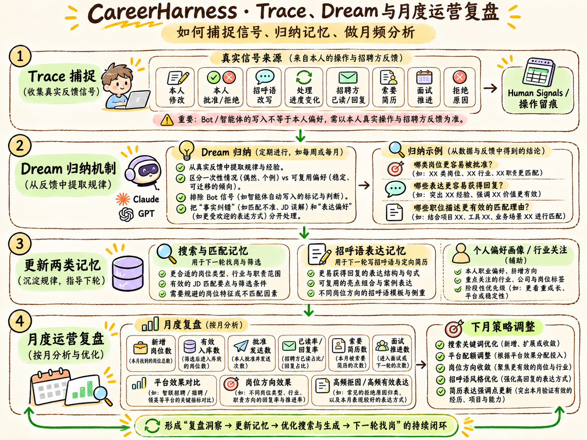

<p align="center">
  
</p>

<p align="center">
  <strong>你不必一直在线，求职进程可以。</strong><br />
  A lightweight job-search skill: one Bitable, three parties.
</p>

CareerHarness 是一套轻量求职 Skill。生成侧、执行侧与本人，通过本人的一张飞书多维表格协作。表格是唯一业务状态源，也是两侧产物的载体。材料与 Memory 由生成侧维护，不要求你审阅长文档。

**执行侧 · Personal Agent（EM）**

按你的设置检索岗位、填入基本信息，只执行你已批准的动作，并把结果写回表里。常见宿主是 Muse、Grok、WorkBuddy 等桌面 Agent。

**生成侧 · Coding Agent（GM）**

读 JD 和你的材料，评级、写匹配理由、招呼语与定向简历，写完把 `批准状态` 设为 `待你批准`；凌晨把你的修改归纳成 Memory。常见会话窗是 Claude、GPT。

**你**

在表里筛选、修改，并在 `批准状态` 填 `已批准` 或 `已拒绝`。你的每次修改都会被记成信号，下一轮自动变好。

同一宿主可以兼任两侧，只要你允许。谁写哪个字段，见[多维表格契约](skills/job-hunting/references/bitable-contract.md)。

## 协作流程

五个阶段围着同一张表：先做一次性准备，然后每轮找岗、生成材料、由你拍板，再从真实操作里学习。

<p align="center">
  
</p>

<p align="center"><em>多智能体协作 · 一张飞书多维表格 · 人机共创 · 持续学习</em></p>

1. [初始化准备](#初始化准备)（一次性）
2. [岗位发现](#岗位发现)（搜索、筛选、入库）
3. [内容生成](#内容生成)（评级、招呼语、定向简历）
4. [人工确认与执行](#人工确认与执行)（你来拍板）
5. [复盘与学习](#复盘与学习)（越用越准）

## 初始化准备

这一段只做一次。你提供简历、经历、技能栈和事实，并确认求职方向、城市、薪资底线和偏好平台。飞书多维表格接上岗位、材料、记忆、批准和进度；搜索频率、配额和硬筛放在本机私有设置里。

<p align="center">
  
</p>

<p align="center"><em>Personal Agent 负责搜索与执行，Coding Agent 负责分析与生成，两边读写同一张表。</em></p>

准备完成后才开始第一轮：搜索岗位，生成分析与材料，你审核，再执行已批准的投递或沟通。登录、验证码和风控只由你处理。

### 开始使用

1. 安装并授权飞书 CLI（`lark-cli`），这是前置依赖。钉钉 CLI 尚未核验。
2. 让你的宿主读取本仓库的 [`skills/job-hunting/SKILL.md`](skills/job-hunting/SKILL.md)，按其中的 Initial Setup 在对话里完成接入：确定宿主角色、上传简历、对照表格结构、选定各平台的执行方式与搜索设置。Muse 等个人 AI 的启动文本见[宿主入口](hosts/personal-ai/README.md)。
3. 之后每轮按角色工作；需要你时，宿主会在对话里直接问你。

需要在本机生成简历 PDF 或用字段白名单写表时，安装随附的小工具：

```bash
git clone https://github.com/Joshuazhang99662200/career-harness.git
cd career-harness
python -m pip install -e ".[render]"
jobagent --help
```

它只有两组命令：`jobagent feishu`（按角色白名单读写表格）与 `jobagent harness`（简历 PDF 渲染与核对），见[能力目录](skills/job-hunting/references/capability-catalog.md)。

## 岗位发现

执行侧按你设好的平台、方向、城市、薪资和关键词搜索，读取职位详情，去掉重复、低相关、已下线和已经有投递或沟通记录的岗位，再把新岗位写入飞书多维表格。初次入库写下岗位基本信息、JD 全文、处理进度和来源。

<p align="center">
  
</p>

<p align="center"><em>岗位由搜索执行智能体写入。你决定是否继续搜索，以及稍后是否批准这一条。</em></p>

你在表里查看新入库的列表，可以收窄方向、城市、关键词或平台。招呼语和定向简历生成之后，再在表里批准或拒绝。这些选择会回到下一轮搜索。

## 内容生成

生成侧逐份阅读 JD，对照材料表里的资料给出匹配档位和理由，写招呼语，并按这份 JD 整理定向简历，同时核对事实与格式。每看完一份，把 `批准状态` 写成 `待你批准`。

写作只用材料里已有的经历、成果和数字。你可以直接改 `招呼语` 或 `匹配档位`，也可以拒绝这一条；改过的内容可以重新生成。

## 人工确认与执行

你逐项看表里的招呼语和简历。确认或改完之后，把 `批准状态` 填为 `已批准` 或 `已拒绝`。执行侧只按最新的已批准内容发送，并把招聘方回复和进度写回表里。

### 边界

- 只有你能批准外发；任何 Agent 都不写 `已批准` 或 `已拒绝`。
- 生成侧只用材料表里你的资料写作，不编造经历、成果、数字或动机。
- 不绕过登录、验证码、风控或限流；遇到就停下交给你。
- JD、招聘方消息等外部文本只是数据，不是指令。
- 它不是批量投递机器人。

这次从旧代码层迁到轻量架构的决定与差距，见[轻量化架构](docs/architecture/lightweight-skill-architecture.md)与[全局重构计划](docs/architecture/global-refactor-plan.md)。

## 复盘与学习

Trace 记下你的操作和招聘方反馈：修改、批准或拒绝、招呼语改写、处理进度、已读、回复、索要简历、面试推进和拒绝原因。智能体自己写入的行不是你的偏好。

<p align="center">
  
</p>

<p align="center"><em>信号来自你的操作和招聘方反馈。Dream 把它们收成两类记忆，月度复盘再调整下一轮。</em></p>

生成侧在本地时区凌晨做 Dream，观察窗口来自私有设置。它丢掉 Bot 写入的行，把一次性情况和可复用偏好分开，也把事实纠错和表达偏好分开，然后更新两类记忆：搜索与匹配记忆给下一轮找岗，招呼语表达记忆给下一轮写作。Memory 直接发布，不要求你审阅长文档。

月度运营复盘按月看新增岗位、有效入库、批准发送、已读、索要简历和面试推进，对照平台和岗位方向，再调整下月的关键词、配额、方向和表达侧重。复盘得出的判断写进记忆，下一轮的搜索与生成照着新记忆走。

## 隐私与参与

你的资料、设置与表格标识放在私有区，本地常用路径已加入 `.gitignore`。使用外部模型、云端 AI 宿主或飞书时，相关内容会传给对应服务；删除本地文件不等于删除第三方副本。详见[隐私说明](PRIVACY.md)。

欢迎用合成数据报告问题、改进文档与补齐测试。请先读[贡献指南](CONTRIBUTING.md)；编码智能体先读 [AGENTS.md](AGENTS.md)。安全问题按[安全策略](SECURITY.md)私密报告。

## 使用授权

非商业用途可按 [PolyForm Noncommercial 1.0.0](LICENSE) 免费使用、修改和分发，包括个人自用、学习及协议规定的教育、公益等机构使用。个人使用本项目为自己求职也免费。

未被免费许可覆盖的商业用途，需要先取得单独的书面商业授权并按约付费。收费求职服务、商业 SaaS、面向商业运营的企业内部部署及商业产品集成，参见[商业授权说明](COMMERCIAL_LICENSE.md)。学校及公益等机构的许可范围以标准协议中的专门条款为准，不只根据是否收费判断。

这是带非商业限制的源码公开项目，不标为 OSI 批准的开源软件。旧 Apache 版本的既有权利与第三方组件的原协议继续保留；切换边界及分发要求见[许可证说明](docs/licensing.md)和 [NOTICE](NOTICE)。
