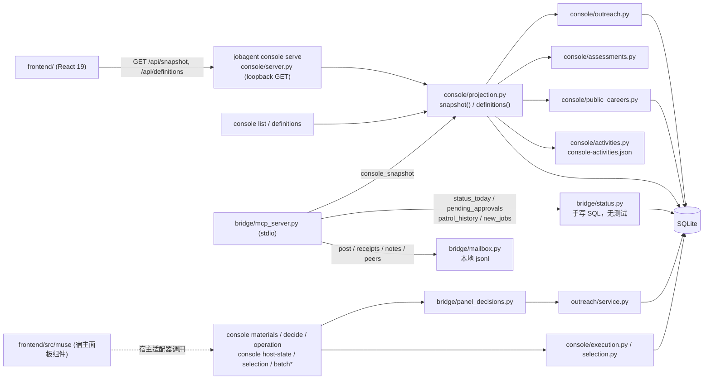
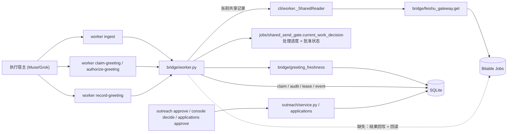
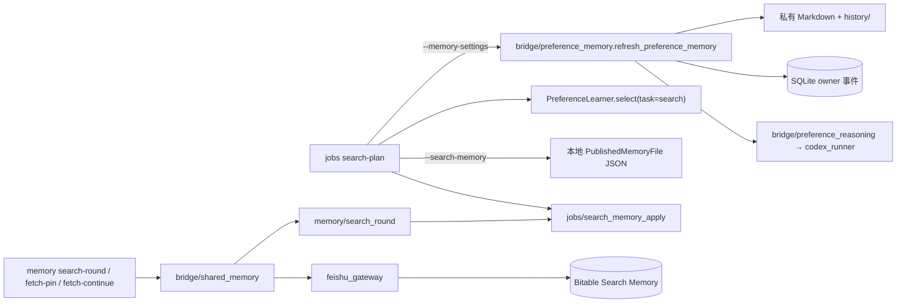
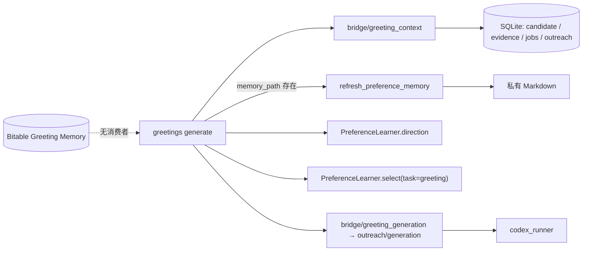
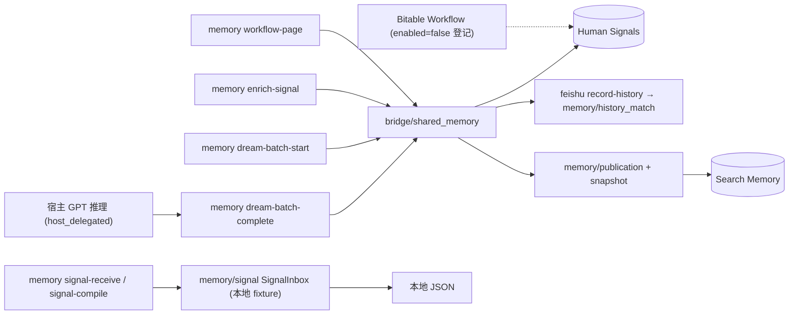
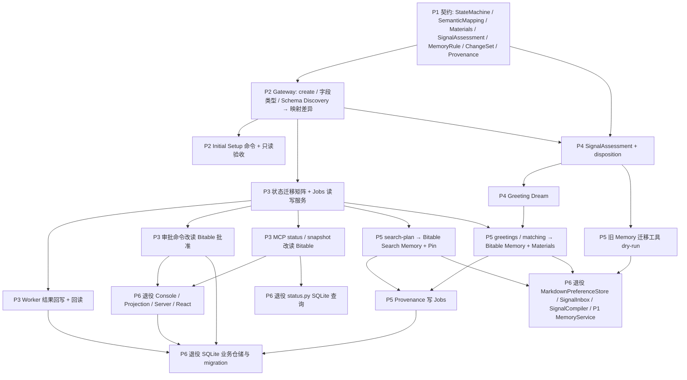

# 消费者依赖图与迁移依赖

基线：PR #36 head `f3eb022`。依赖关系由 AST 解析 `src/` 与 `tests/` 的 import 得出（516 个模块节点），再人工核对入口函数。箭头 `A → B` 表示 A 调用 / 读取 B。

## 1. 当前真实调用链

### 1.1 展示层：React / Console / MCP

结论：React 与 MCP 共用 `console.projection`；MCP 另有 4 个工具直连 SQLite。**退役 Console 前必须先给 MCP 提供 Bitable 数据源**，否则 MCP 断裂。`bridge/status.py` 没有任何测试覆盖。

### 1.2 审批与执行：Worker / Outreach

结论：只有 Worker 首条招呼的发送裁决消费 Bitable；其余审批命令仍写 SQLite 审批表，执行结果不回写 Bitable。

### 1.3 Search Plan / Fetch

结论：`search-plan` 与 `search-round` 是两条并行链；前者有三种 Memory 来源（无、Markdown、本地 JSON），后者只读 Bitable。目标是 `search-plan` 只走右侧链路并输出 Pin + Provenance。

### 1.4 Greeting

### 1.5 Dream / Signal

## 2. 迁移依赖图（必须满足的先后关系）

## 3. 高风险耦合点

| 耦合 | 位置 | 风险 | 处理 |
|---|---|---|---|
| MCP 依赖 Console Projection | `bridge/mcp_server.py:20-21` | 删 Console 会让 MCP 失去快照工具 | P3 先改 MCP 数据源 |
| `outreach/service.py` 被 16 个源模块引用 | patrol / pipeline_sync / job_intake_service / sent_tracking / conversation 等 | 审批与审计改动波及面最大 | 先抽出“读 Bitable 批准”的端口，再逐个替换调用方 |
| `storage.database` 被 64 个源模块、61 个测试依赖 | 全仓 | 一次性删库会让大量测试失效 | 按域退役，每域独立 PR |
| `schemas/preference_memory` 被 11 个测试引用 | G1 测试群 | 迁移 MemoryRule 时测试需要成对迁移 | 先建新模型与转换函数，再迁测试 |
| `greeting_context` 直读 candidate / evidence / outreach 表 | `bridge/greeting_context.py` | Materials 迁移依赖它 | 引入 `MaterialsReader` 端口 |
| Candidate Evidence 硬性边界 | `CandidateEvidenceService.confirm` | 存储迁移不得绕过唯一提升入口 | 见审计 §5.1 |
| `cli/jobs.py`（1269 行）同时承载 search-plan 三种 Memory 来源 | `cli/jobs.py:703-814` | 切换时容易残留 fallback | P5 删除 `--memory-settings` / `--search-memory`，Memory 不可用即报错 |

## 4. 无消费者 / 孤立项

- 表 `outreach_audits_next`：migration 0011 创建，无任何代码引用。
- `bridge/sourcing_feedback.py`：无 src 消费者、无测试。
- `bridge/codex_reasoning.py`：无 src 消费者，仅 1 个测试。
- `memory/search_round.py`：无直接测试（经 `shared_memory` 间接覆盖）。
- `bridge/status.py`：仅 MCP 使用，无测试。
